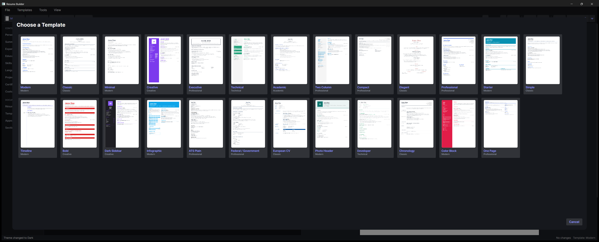

# ResumeBuilder

A cross-platform desktop resume builder: edit a resume in a live editor, see a real-time PDF preview, pick from 25 templates, and export to PDF, DOCX, HTML, PNG, plain text, or JSON Resume.

**Free, local, and account-free.** Resumes are stored in a local SQLite database. AI can run against a local model (Ollama, LM Studio) for offline use. If you choose cloud AI, relevant text is sent to that provider. Folder sync can use your own cloud-synced folder.

## Download

On Windows, install through winget:

```
winget install Gentian28.ResumeBuilder
```

Or grab the latest build from the [releases page](https://github.com/Gentian28/resume-builder/releases).

| Platform | Download | Notes |
| --- | --- | --- |
| Windows | `ResumeBuilder-win-Setup.exe` | Installer, updates itself. `win-Portable.zip` if you'd rather not install. |
| Linux | `ResumeBuilder.AppImage` | `chmod +x` and run. Needs `libfontconfig1`, present on most desktops. |
| macOS, Apple silicon | `ResumeBuilder-osx-Setup.pkg` | M1 and later. See the Gatekeeper note below. |
| macOS, Intel | `ResumeBuilder-osx-x64-Setup.pkg` | Macs with an Intel processor. Choose the package matching About This Mac. |

Not sure which Mac you have? Apple menu → About This Mac.

No .NET runtime needed: every build is self-contained.

`SHA256SUMS-*.txt` is published with every release so you can verify what you downloaded.

### Code signing

Windows builds are not yet code-signed. The [SignPath Foundation](https://signpath.org/)
application was declined in July 2026; reapplication remains pending. Direct downloads can
show an unknown-publisher warning. Windows applies [reputation and security checks](https://learn.microsoft.com/en-us/windows/apps/package-and-deploy/smartscreen-reputation)
according to the device's settings. Download only from the official release page and compare
the published SHA-256 checksum. Winget is another installation route, not a signing guarantee.
macOS packages are not yet notarised and can require approval under System Settings, Privacy & Security.

### Privacy

The app has no account, no telemetry and no analytics. See [PRIVACY.md](PRIVACY.md) for exactly
what is stored and the three cases where it touches the network.

## Features

- **Live preview**: the editor renders the selected template to a paged PDF preview as you type.
- **25 resume templates**: Modern, Classic, Minimal, Creative, Executive, Technical, Academic, Two Column, Compact, Elegant, Professional, Starter, Simple, Timeline, Bold, Dark Sidebar, Infographic, ATS Plain, Chronology, Color Block, Developer, Europass, Federal, One Page, Photo Header, plus 3 cover-letter templates.
- **Section ordering and visibility**: reorder or hide any section, including custom sections.
- **Export**: PDF, DOCX, HTML, PNG, plain text (ATS-friendly), native JSON, and [JSON Resume](https://jsonresume.org/).
- **Import**: JSON Resume, native JSON, LinkedIn data export (.zip), Word (.docx), and PDF text extraction. A persistent review banner keeps warnings next to the editor.
- **Spell check**: Hunspell, with a personal dictionary.
- **ATS keyword analysis**: paste a job description to get a match score, matched/missing keywords, and warnings.
- **AI assistance**: optional; works against OpenAI or any OpenAI-compatible endpoint, including a local LLM (Ollama, LM Studio).
- **First session**: open a bundled synthetic example, edit it, review its extracted PDF text and export. Existing saved work stays separate.
- **Document layout**: choose A4 or US Letter and English or Albanian generated headings and dates. User-authored text is preserved.
- **Find and follow up**: search grouped resumes, filter applications, edit applied/next-action dates and contacts, and export CSV or calendar events.
- **Cover-letter controls**: select a template, edit sender details and explicitly change the captured source with undo support.
- **Support diagnostics**: preview and copy software/OS details and fixed error codes without document content, paths or keys.
- **Undo/redo**: across text edits and list operations.
- **Sync**: two-way sync through a local folder, with conflict detection. The sync panel finds your Google Drive, OneDrive, Dropbox or iCloud folder and offers it as one button; no account, no upload.
- **Applications**: track which résumé went to which company, when, and what happened; one click reopens the exact version they read. Anything silent for more than a fortnight is marked worth chasing.
- **Backups before upgrades**: the database is copied before any upgrade that changes its schema, and the last three copies are kept.
- **Complete workspace recovery**: Workspace backup (JSON) saves all resumes, cover letters, applications and sent-content snapshots. Import that file to restore the workspace, with validation and a safety copy before replacement. Older single-resume JSON backups still import as individual resumes.
- **Persistent preferences**: your model endpoint, model choice, sync destination and last open resume survive restarts. API keys remain in memory for the current session.



For a first run, choose Open example resume, edit a field, choose a template and export PDF. Review export shows the current page count, basic warnings and extracted text. You can also import the synthetic [sample resume](samples/sample-resume.json). Use Open or Show in folder on the export confirmation to find the result.

Workspace backups contain your personal documents. Keep them in a location you trust. Restoring replaces the local document workspace and pauses folder sync until you configure it again. Marking a draft application as sent captures its resume, linked letter and generated PDFs. These are the documents captured at that moment, not a verification of an externally uploaded file. Saved PDFs stay available after source edits or deletion. A sent application opens its captured content as a separate editable copy, so changing that copy does not change the historical record. Older application records remain live links because their original sent content is unknown.

## Building from source

Requirements:

- [.NET 10 SDK](https://dotnet.microsoft.com/download) or later
- Windows, macOS, or Linux (the UI is [Avalonia](https://avaloniaui.net/))

## Getting started

```bash
git clone https://github.com/Gentian28/resume-builder.git
cd resume-builder

dotnet restore ResumeBuilder.sln
dotnet build ResumeBuilder.sln
dotnet run --project src/ResumeBuilder.App/ResumeBuilder.App
```

Run the tests:

```bash
dotnet test ResumeBuilder.sln
```

`samples/sample-resume.json` is a synthetic JSON Resume file you can import to see the app populated.

## Project layout

The solution is layered; each project depends only on the ones above it.

| Project | Responsibility |
| --- | --- |
| `ResumeBuilder.Core` | Domain models, validation, undo/redo, spell check, keyword analysis, AI, sync. No UI, no persistence. |
| `ResumeBuilder.Data` | EF Core + SQLite persistence. Owns the `Resume` schema and repository. |
| `ResumeBuilder.Templates` | QuestPDF template implementations and the template registry. |
| `ResumeBuilder.Export` | Exporters (PDF/DOCX/HTML/PNG/TXT/JSON) and importers (JSON Resume, LinkedIn, PDF). |
| `ResumeBuilder.App` | Avalonia desktop UI (MVVM, CommunityToolkit.Mvvm). |
| `ResumeBuilder.Tests` | xUnit tests across Core, Data, Export, and Templates. |
| `ResumeBuilder.App.Tests` | Editor workflow and command-routing regressions. |
| `ResumeBuilder.Ui.Tests` | Headless layout, binding and keyboard checks in light/dark themes. |

Dependency direction: `App → {Core, Data, Templates, Export}`, `Export → {Core, Templates}`, `Data → Core`, `Templates → Core`.

### Where things live

- **Data storage**: `%LocalAppData%/ResumeBuilderData/resumes.db` on Windows (SQLite), outside the installer folder so uninstalling preserves work. The older Windows workspace is copied safely on first launch without replacing an existing destination. macOS uses `~/Library/Application Support/ResumeBuilder`; Linux uses `$XDG_DATA_HOME/ResumeBuilder` or `~/.local/share/ResumeBuilder`. Schema upgrades keep a safety backup.
- **Preferences**: `preferences.json` beside the database stores non-secret settings. Theme selection remains in `settings.json`.
- **Dictionaries**: `Dictionaries/` inside the data folder (downloaded on first spell check).
- **Sync history**: destination-specific state files beside the database keep separate deletion and conflict histories for each sync folder.

## Adding a template

1. Add a class under `ResumeBuilder.Templates/Templates/` deriving from `BaseTemplate`.
2. Fill in its `Info` (`Id`, `Name`, `Description`, `Category`, `Layout`, and its default accent color / font).
3. Drive the body from `GetOrderedSections()` and `ShouldRenderSection(...)` so the user's section order and visibility are honored, and use the shared `Compose*` helpers on `BaseTemplate` for standard blocks.
4. Register it in `TemplateRegistry`.

The template smoke test renders every registered template against a fully populated resume, so a new template is covered as soon as it is registered.

## Configuration

The AI features are off until configured. They target any OpenAI-compatible `/chat/completions` endpoint:

- **OpenAI**: supply an API key. Requests (including your resume text) go to `api.openai.com`.
- **Local LLM**: point the base URL at a loopback address (Ollama, LM Studio). No key is needed and nothing leaves your machine.

For volunteer usability sessions and privacy-preserving observation, use the [session kit](docs/usability-session-kit.md). `scripts/verify-distribution.ps1` verifies the currently published installer links and checksums.

## License

[MIT](LICENSE), © 2026 Gentian Shkembi.

The application's source is MIT licensed; dependencies retain their own licenses.
**QuestPDF 2026.7.2**, which renders the templates, uses a source-available Community
License, not MIT or another OSI-approved license. Its [license selection guide](https://www.questpdf.com/license/guide.html)
includes qualifying open-source projects among those eligible for free use. Commercial
forks and other uses must check the applicable [Community License](https://www.questpdf.com/license/community.html)
and eligibility rules rather than assuming the application's MIT license covers QuestPDF.

The test suite uses [AwesomeAssertions](https://github.com/AwesomeAssertions/AwesomeAssertions),
the Apache-2.0 community fork of FluentAssertions.
